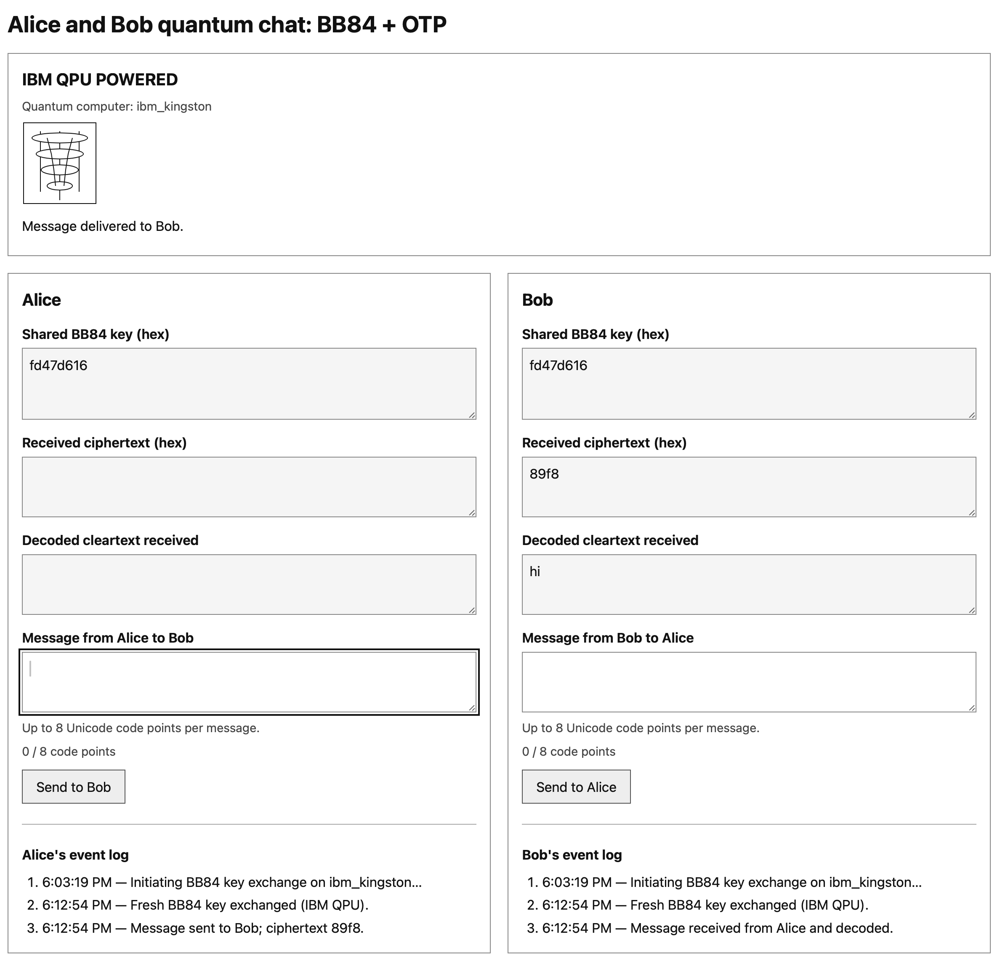
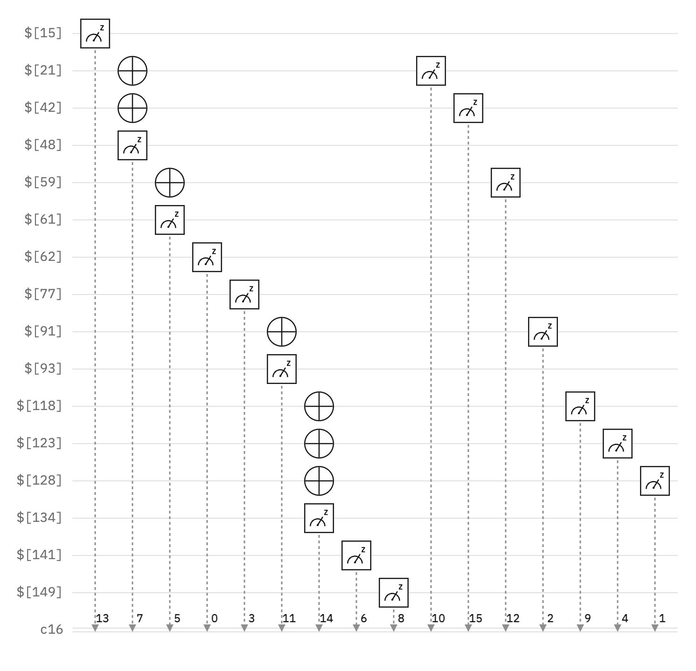
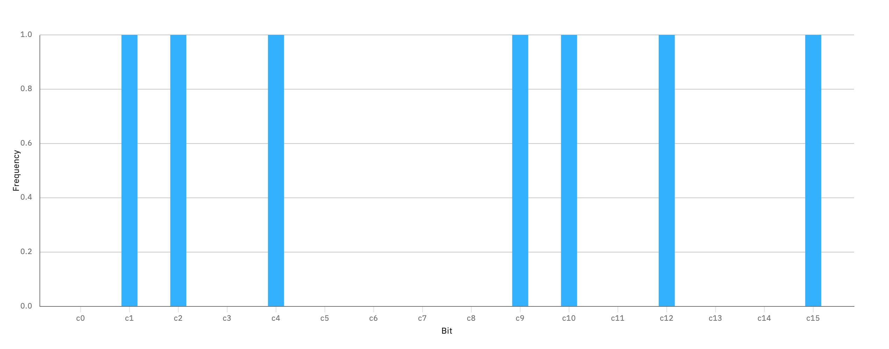

# qipher

**A toy BB84 and quantum one-time-pad (QOTP) chat demo. Not a secure
messaging or deployable QKD.** Alice and Bob appear in one local
web page. Circuits run on a simulator by default or on an IBM QPU
when configured.



## Quantum Vernam (QOTP)

`src/vernam.py` turns each plaintext bit into a qubit, $|0\rangle$ or
$|1\rangle$. Alice masks it with two key bits using the Pauli gates:

- $X$ **flips the bit**: $|0\rangle\leftrightarrow|1\rangle$.
- $Z$ **changes the phase** of $|1\rangle$ (it becomes $-|1\rangle$)
  without changing a $0/1$ measurement.

Their matrices (rows shown on separate lines) are:

```text
X = | 0  1 |     Z = | 1   0 |
    | 1  0 |         | 0  -1 |
```

Alice applies $Z$ if the second key bit is 1, then $X$ if the first is 1.
Bob undoes those gates in reverse order: $X$ first, then $Z$. Each gate
undoes itself ($X^2=Z^2=I$), so Bob recovers the original qubit.

One UTF-8 byte has eight bits, so it uses eight qubits and **16 key bits**
(two per qubit). Eight ASCII characters need 128 key bits; eight
four-byte emoji need 512. The web app allows at most eight Unicode code
points per message.

This demo measures the ciphertext and sends classical bytes. For its
$|0\rangle$/$|1\rangle$ inputs, $Z$ changes phase but not the displayed
ciphertext bits; it does not send encrypted qubits between Alice and Bob.

## BB84 key exchange

`src/bb84.py` implements Alice and Bob's BB84 roles. They independently
choose random bases: the computational ($Z$) basis
$\{|0\rangle,|1\rangle\}$ or the diagonal ($X$) basis
$\{|+\rangle,|-\rangle\}$. The Hadamard gate changes between these bases:

```text
H = (1/√2) | 1   1 |
           | 1  -1 |
```

Here $|+\rangle=H|0\rangle$ and $|-\rangle=H|1\rangle$.

1. Alice chooses a random bit and basis per qubit. She applies $X$ for
   bit 1 and $H$ for the diagonal basis.
2. Bob independently chooses a basis; he applies $H$ for the diagonal
   basis, then measures.
3. They compare **bases, not secret bits**, and discard positions where
   the bases differ. On average, about half survive this sifting step.
4. They reveal and discard a random sample of matching bits to estimate
   the error rate. The demo aborts above 11% sample errors or if the
   remaining local keys disagree. The unrevealed sifted bits become the
   fresh key returned by `generate_otp_key` for that message.

The circuits use up to eight qubits per batch. With no token, Qiskit's
BasicSimulator measures them; with a configured IBM QPU, SamplerV2 runs
them on that backend. The sample check and threshold are teaching
mechanics, **not a security proof**.

## Run the web app

From the repository root, start in **simulator mode**:

```sh
unset QISKIT_IBM_TOKEN QISKIT_IBM_BACKEND
python webapp.py
```

To use an **IBM QPU**, put only your raw IBM Quantum Platform API token in
`~/.ibm` (no quotes or `export`). 

```sh
chmod 600 "$HOME/.ibm"
. ./load-ibm-token.sh
python webapp.py
```

Restart `python webapp.py` to switch modes. The server listens only on
`127.0.0.1:8000`; open <http://127.0.0.1:8000/>. Alice is on the left,
Bob on the right. Sending triggers a new local BB84 exchange, QOTP
encryption, and decoding in the receiver's panel. Both panels show the
shared key; the receiver's ciphertext and cleartext appear only on
delivery. In QPU mode, both event logs announce the BB84 exchange when
it begins.

## Example circuit and job output





## Bibliography

- Thomas Vidick, [*Quantum Cryptography* (CS/Ph 120 course materials)](https://www.weizmann.ac.il/math/vidick/teaching-lecture-notes).
